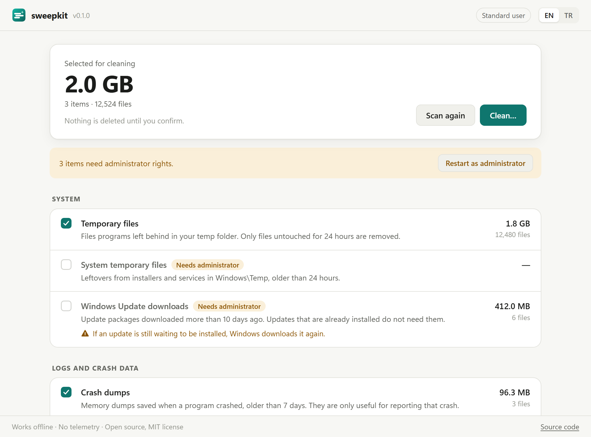

<p align="center">
  
</p>

<h1 align="center">sweepkit</h1>

<p align="center">
  Honest disk cleanup for Windows and Linux.<br>
  <a href="README.tr.md">Türkçe</a>
</p>

<p align="center">
  <a href="https://github.com/bugraskl/sweepkit/actions/workflows/ci.yml"></a>
  <a href="https://github.com/bugraskl/sweepkit/releases/latest"></a>
  <a href="LICENSE"></a>
</p>

---

sweepkit shows you which files are safe to delete, tells you what deleting
them costs, and deletes nothing until you confirm. It has no ads, no
telemetry, no network access and no "RAM booster".

<p align="center">
  <picture>
    <source media="(prefers-color-scheme: dark)" srcset="docs/screenshot-dark.png">
    
  </picture>
</p>

## Why another cleaner?

Most "PC cleaners" sell a feeling of speed rather than free space. sweepkit
started as a response to one of them, [G-CACHE](https://guldaltech.com/). Its
site (as of September 2026) advertises resetting the working sets of
background processes, deleting Prefetch, clearing browser caches and
flushing DNS "to improve internet speed", permanently emptying the Recycle
Bin, and repeating all of it silently in the background, for example every
60 minutes. Each of those is in the
[table below](#what-it-deliberately-does-not-do), with the reason sweepkit
leaves it out. The same techniques are common across the whole category; the
point is the techniques, not one project.

sweepkit only does the part that holds up: it removes files that are
genuinely left over, shows you exactly how much space that frees, and is
upfront when cleaning something has a cost.

## What it cleans

| Target | Default | Needs admin | What goes |
|---|:-:|:-:|---|
| **Windows** | | | |
| Temporary files | ✓ | | Files in your temp folder untouched for 24 hours |
| System temporary files | ✓ | ✓ | `Windows\Temp`, older than 24 hours |
| Windows Update downloads | | ✓ | Update packages downloaded more than 10 days ago |
| Crash dumps | ✓ | | Program crash dumps older than 7 days |
| System crash dumps | ✓ | ✓ | Minidumps, `LiveKernelReports`, `MEMORY.DMP` older than 7 days |
| Error reports | ✓ | | Windows Error Reporting files older than 7 days |
| System error reports | ✓ | ✓ | Shared Windows Error Reporting files older than 7 days |
| GPU shader caches | | | DirectX, NVIDIA, AMD and Intel shader caches |
| **Linux** | | | |
| Thumbnail cache | ✓ | | Thumbnails older than 30 days |
| APT / DNF package cache | ✓ | ✓ | Runs `apt-get clean` or `dnf clean packages` |
| Pacman package cache | ✓ | ✓ | Keeps the two newest versions of each package, like `paccache -rk2` |
| Old system logs | ✓ | ✓ | Runs `journalctl --vacuum-time=30d` |
| Crash dumps | ✓ | ✓ | systemd core dumps older than 7 days |
| **Both** | | | |
| Browser caches | | | Chrome, Chromium, Edge, Brave, Vivaldi, Opera, Firefox. Only the cache: never cookies, history, passwords or sessions |
| Developer caches | | | npm, pip, Go build, Yarn and NuGet caches, respecting `npm_config_cache`, `PIP_CACHE_DIR`, `GOCACHE` and friends |

Run `sweepkit list` to see which targets exist on your system.

## What it deliberately does not do

| Common "optimization" | Why sweepkit skips it |
|---|---|
| "Freeing" RAM by trimming working sets | Windows already does this when memory is needed. Forcing it makes programs page their memory back in, which is slower. Unused RAM is wasted RAM. |
| Deleting Prefetch | Prefetch makes programs start faster. Deleting it slows the next launches and frees a few megabytes. |
| Registry cleaning | No measurable benefit, real risk of breaking software. |
| Clearing browser caches on a schedule | A cache exists to make pages load faster. sweepkit offers it once, opt-in, and tells you the cost. |
| Emptying the Recycle Bin | It is your safety net. sweepkit never touches it. |
| Flushing DNS "to speed up the internet" | It does not. It only helps when troubleshooting a stale record. |
| Running silently in the background | sweepkit runs when you run it. See [scheduling](#scheduling) if you want that. |

## How it stays safe

- **Look first.** `scan` and the app's first screen only read. Nothing is
  deleted until you confirm, and the CLI refuses to delete without a terminal
  unless you pass `--yes`.
- **Age thresholds.** Each target only takes files that have not been
  modified for a while (24 hours for temp files), so files in active use stay.
- **Personal folders are sealed.** Documents, Desktop, Downloads, Pictures,
  Music, Videos, OneDrive and their localized Linux equivalents (for example
  `~/Belgeler`) are never touched, even if a setting points there.
- **System folders are protected.** A folder like your home, `AppData`,
  `C:\Windows` or `/var` can never be cleaned as a whole, and folders such as
  `System32`, `WinSxS`, `Program Files`, `/usr` and `/etc` are sealed.
- **Links are never followed.** Symlinks, junctions, mount points and cloud
  placeholders are skipped, and walks never cross into another filesystem.
- **Traversal-resistant deletion.** Every file is re-checked right before it
  is deleted, through a handle to its folder (Go's `os.Root`). A folder
  swapped for a link after the scan cannot redirect a deletion elsewhere.
- **In-use files are left alone,** and browser caches are only cleaned while
  the browser is closed.
- **Package managers clean themselves.** APT, DNF and journald targets run the
  distribution's own command instead of deleting its files.
- **No network.** The CLI does not even link Go's networking packages; CI
  checks this on every commit.

Found a way to make it delete something it should not? Please see
[SECURITY.md](SECURITY.md).

## Install

Download the latest release from the
[releases page](https://github.com/bugraskl/sweepkit/releases/latest):

| System | File |
|---|---|
| Windows (x64 / ARM) | `sweepkit_<version>_windows_amd64.zip` / `_arm64.zip`. Unzip anywhere; nothing to install. |
| Debian, Ubuntu, Mint, Pop!_OS… | `sweepkit_<version>_amd64.deb` |
| Fedora, RHEL, Rocky, Alma… | `sweepkit-<version>-1.x86_64.rpm` |
| Arch, Manjaro, EndeavourOS… | `sweepkit-<version>-1-x86_64.pkg.tar.zst` |
| Any Linux | `sweepkit_<version>_linux_amd64.tar.gz` / `_arm64.tar.gz` |

Each archive contains the command-line tool `sweepkit` and the desktop app
`sweepkit-gui`. The desktop app needs WebView2 on Windows (built into Windows
10 and 11) and WebKitGTK 4.1 on Linux; the packages pull it in.

The Windows binaries are not code-signed yet, so SmartScreen may warn about
an unknown publisher. You can verify every file instead:

```sh
# Checksums
sha256sum --check --ignore-missing SHA256SUMS.txt
# Proof that GitHub Actions built the file from this repository
gh attestation verify sweepkit_0.1.0_windows_amd64.zip --repo bugraskl/sweepkit
```

With Go 1.26 or newer you can also build the CLI yourself:

```sh
go install github.com/bugraskl/sweepkit/cmd/sweepkit@latest
```

## Usage

The desktop app scans on start, pre-selects the safe defaults and shows the
cost of every optional item. On Windows it can restart itself as
administrator to include system items.

The command-line tool:

```console
$ sweepkit scan
      SIZE    FILES  TARGET
    2.0 GB    75110  Temporary files [temp]
   28.8 MB        4  Crash dumps [crash-dumps]
   4.0 MB+       90  System error reports [system-error-reports] (needs administrator)

Ready to clean: 2.0 GB in 75114 files.

$ sweepkit clean
...
Permanently delete 75114 files (2.0 GB)? They are not moved to the Recycle Bin. [y/N] y
Cleaning Temporary files... deleted 75002 files, freed 2.0 GB, 112 in use and left alone
```

| Command | What it does |
|---|---|
| `sweepkit list` | Every target, whether it is on by default, needs admin and exists here |
| `sweepkit scan` | What would be deleted. Changes nothing |
| `sweepkit clean` | Deletes it after asking |
| `--all` | Include optional targets such as browser and developer caches |
| `--only a,b` / `--skip a,b` | Choose targets by ID |
| `--yes` | Do not ask (for scripts) |
| `--json` | Machine-readable output |

System targets need an elevated terminal on Windows or `sudo` on Linux. Under
`sudo`, sweepkit still cleans the invoking user's caches, not root's.

## Scheduling

sweepkit has no background service. If you want regular cleanups, let the
operating system run it.

**Windows**, weekly, from a normal terminal:

```powershell
schtasks /Create /SC WEEKLY /D SUN /ST 12:00 /TN sweepkit /TR "C:\Tools\sweepkit\sweepkit.exe clean --yes"
```

**Linux**, as a systemd user timer:

```ini
# ~/.config/systemd/user/sweepkit.service
[Service]
Type=oneshot
ExecStart=/usr/bin/sweepkit clean --yes

# ~/.config/systemd/user/sweepkit.timer
[Timer]
OnCalendar=weekly
Persistent=true

[Install]
WantedBy=timers.target
```

```sh
systemctl --user enable --now sweepkit.timer
```

## Building from source

See [CONTRIBUTING.md](CONTRIBUTING.md). In short: Go 1.26+, and for the
desktop app [Wails v2](https://wails.io) (plus `libgtk-3-dev` and
`libwebkit2gtk-4.1-dev` on Linux).

```sh
go test ./internal/... ./cmd/...
go build ./cmd/sweepkit
wails build                      # Windows
wails build -tags webkit2_41     # Linux
```

## License

[MIT](LICENSE) © 2026 Buğra Şıkel
