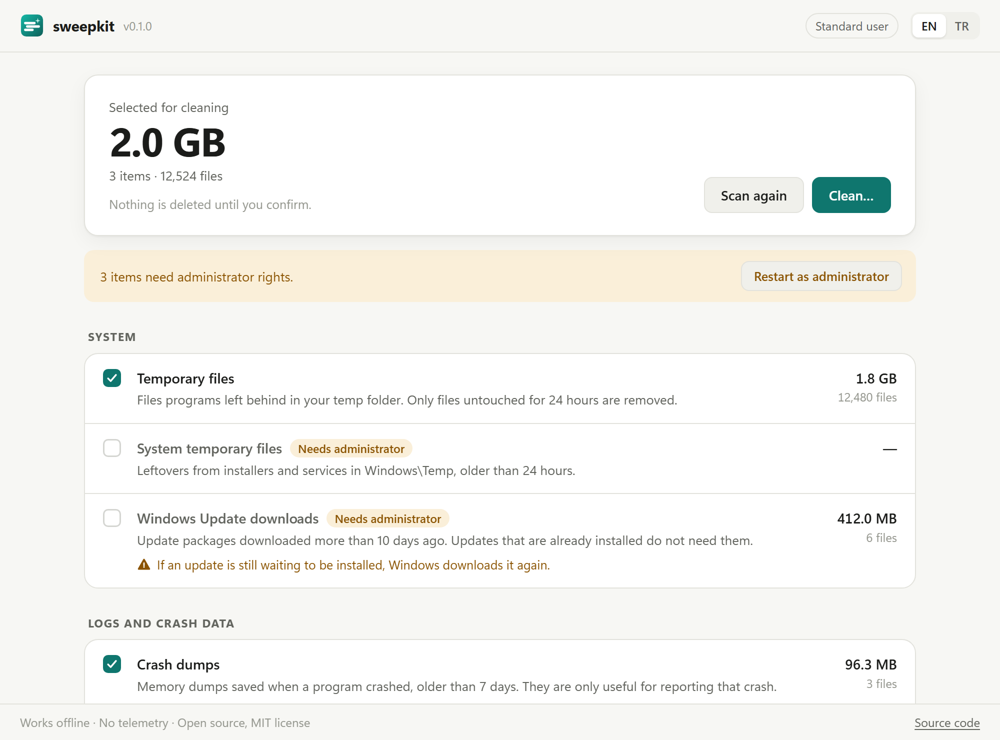

<p align="center">
  
</p>

<h1 align="center">sweepkit</h1>

<p align="center">
  Windows ve Linux için dürüst disk temizliği.<br>
  <a href="README.md">English</a>
</p>

<p align="center">
  <a href="https://github.com/bugraskl/sweepkit/actions/workflows/ci.yml"></a>
  <a href="https://github.com/bugraskl/sweepkit/releases/latest"></a>
  <a href="LICENSE"></a>
</p>

---

sweepkit hangi dosyaların güvenle silinebileceğini gösterir, silmenin neye
mal olacağını söyler ve siz onaylamadan hiçbir şey silmez. Reklam yok,
telemetri yok, ağ erişimi yok, "RAM hızlandırıcı" yok.

<p align="center">
  <picture>
    <source media="(prefers-color-scheme: dark)" srcset="docs/screenshot-dark.png">
    
  </picture>
</p>

## Neden bir temizleyici daha?

"PC temizleyicilerin" çoğu hız hissi satar. Görev Yöneticisi'ndeki bir sayı
düşsün diye çalışan programların belleğini kırpar, programlar daha yavaş
açılsın diye Windows'un Prefetch verisini siler, sayfalar daha yavaş yüklensin
diye tarayıcı önbelleğini saatte bir temizler ve Geri Dönüşüm Kutusu'nu
habersizce boşaltır.

sweepkit yalnızca gerçekten işe yarayan kısmı yapar: gerçekten artık kalmış
dosyaları kaldırır, ne kadar yer açılacağını tam olarak gösterir ve bir şeyi
temizlemenin bedeli varsa bunu açıkça söyler.

## Neleri temizler

| Hedef | Varsayılan | Yönetici | Ne silinir |
|---|:-:|:-:|---|
| **Windows** | | | |
| Geçici dosyalar | ✓ | | Geçici klasörde 24 saattir dokunulmamış dosyalar |
| Sistem geçici dosyaları | ✓ | ✓ | `Windows\Temp`, 24 saatten eski olanlar |
| Windows Update indirmeleri | | ✓ | 10 günden önce indirilmiş güncelleme paketleri |
| Çökme dökümleri | ✓ | | 7 günden eski program çökme dökümleri |
| Sistem çökme dökümleri | ✓ | ✓ | 7 günden eski minidump, `LiveKernelReports`, `MEMORY.DMP` |
| Hata raporları | ✓ | | 7 günden eski Windows Hata Raporlama dosyaları |
| Sistem hata raporları | ✓ | ✓ | 7 günden eski ortak Windows Hata Raporlama dosyaları |
| GPU gölgelendirici önbellekleri | | | DirectX, NVIDIA, AMD ve Intel gölgelendirici önbellekleri |
| **Linux** | | | |
| Küçük resim önbelleği | ✓ | | 30 günden eski küçük resimler |
| APT / DNF paket önbelleği | ✓ | ✓ | `apt-get clean` veya `dnf clean packages` çalıştırır |
| Pacman paket önbelleği | ✓ | ✓ | `paccache -rk2` gibi her paketin en yeni iki sürümünü tutar |
| Eski sistem günlükleri | ✓ | ✓ | `journalctl --vacuum-time=30d` çalıştırır |
| Çökme dökümleri | ✓ | ✓ | 7 günden eski systemd çökme dökümleri |
| **İkisi de** | | | |
| Tarayıcı önbellekleri | | | Chrome, Chromium, Edge, Brave, Vivaldi, Opera, Firefox. Yalnızca önbellek: çerezler, geçmiş, şifreler ve oturumlar asla silinmez |
| Geliştirici önbellekleri | | | npm, pip, Go derleme, Yarn ve NuGet önbellekleri; `npm_config_cache`, `PIP_CACHE_DIR`, `GOCACHE` gibi ayarlara uyar |

Sisteminizde hangi hedeflerin bulunduğunu görmek için `sweepkit list` çalıştırın.

## Bilerek yapmadıkları

| Yaygın "optimizasyon" | sweepkit neden yapmaz |
|---|---|
| Çalışma kümelerini kırparak RAM'i "boşaltmak" | Windows bunu zaten bellek gerektiğinde yapar. Zorlamak, programların belleklerini geri yüklemesine neden olur ve bu daha yavaştır. Kullanılmayan RAM boşa giden RAM'dir. |
| Prefetch'i silmek | Prefetch programların daha hızlı açılmasını sağlar. Silmek sonraki açılışları yavaşlatır ve birkaç megabayt yer açar. |
| Kayıt defteri temizliği | Ölçülebilir faydası yok, yazılımları bozma riski gerçek. |
| Tarayıcı önbelleğini düzenli temizlemek | Önbellek sayfaların daha hızlı açılması için vardır. sweepkit bunu bir kez, isteğe bağlı olarak sunar ve bedelini söyler. |
| Geri Dönüşüm Kutusu'nu boşaltmak | O sizin güvenlik ağınız. sweepkit ona asla dokunmaz. |
| "İnterneti hızlandırmak" için DNS temizlemek | Hızlandırmaz. Yalnızca eskimiş bir kaydı giderirken işe yarar. |
| Arka planda sessizce çalışmak | sweepkit siz çalıştırdığınızda çalışır. İsterseniz [zamanlama](#zamanlama) bölümüne bakın. |

## Nasıl güvenli kalır

- **Önce bakar.** `scan` ve uygulamanın ilk ekranı yalnızca okur. Siz
  onaylamadan hiçbir şey silinmez; komut satırı aracı terminal dışında
  `--yes` verilmeden silmeyi reddeder.
- **Yaş eşikleri.** Her hedef yalnızca bir süredir değişmemiş dosyaları alır
  (geçici dosyalar için 24 saat); kullanılmakta olan dosyalar kalır.
- **Kişisel klasörler mühürlüdür.** Belgeler, Masaüstü, İndirilenler,
  Resimler, Müzik, Videolar, OneDrive ve Linux'taki yerelleştirilmiş
  karşılıkları (örneğin `~/Belgeler`) bir ayar oraya işaret etse bile asla
  silinmez.
- **Sistem klasörleri korunur.** Ev klasörünüz, `AppData`, `C:\Windows` veya
  `/var` gibi bir klasör hiçbir zaman bütünüyle temizlenemez; `System32`,
  `WinSxS`, `Program Files`, `/usr` ve `/etc` gibi klasörler mühürlüdür.
- **Bağlantılar asla izlenmez.** Sembolik bağlantılar, junction'lar, bağlama
  noktaları ve bulut yer tutucuları atlanır; tarama başka bir dosya sistemine
  geçmez.
- **Kök dışına kaçamayan silme.** Her dosya silinmeden hemen önce klasörüne
  açılmış bir tanıtıcı (Go'nun `os.Root`'u) üzerinden yeniden kontrol edilir.
  Taramadan sonra bir bağlantıyla değiştirilen klasör, silmeyi başka bir yere
  yönlendiremez.
- **Kullanımdaki dosyalara dokunulmaz;** tarayıcı önbellekleri yalnızca
  tarayıcı kapalıyken temizlenir.
- **Paket yöneticileri kendi kendini temizler.** APT, DNF ve journald
  hedefleri dosyaları silmek yerine dağıtımın kendi komutunu çalıştırır.
- **Ağ yok.** Komut satırı aracı Go'nun ağ paketlerini hiç içermez; CI bunu
  her commit'te kontrol eder.

Silmemesi gereken bir şeyi sildirmenin bir yolunu buldunuz mu? Lütfen
[SECURITY.md](SECURITY.md) dosyasına bakın.

## Kurulum

Son sürümü [sürümler sayfasından](https://github.com/bugraskl/sweepkit/releases/latest)
indirin:

| Sistem | Dosya |
|---|---|
| Windows (x64 / ARM) | `sweepkit_<sürüm>_windows_amd64.zip` / `_arm64.zip`. İstediğiniz yere açın; kurulum gerekmez. |
| Debian, Ubuntu, Mint, Pop!_OS, Pardus… | `sweepkit_<sürüm>_amd64.deb` |
| Fedora, RHEL, Rocky, Alma… | `sweepkit-<sürüm>-1.x86_64.rpm` |
| Arch, Manjaro, EndeavourOS… | `sweepkit-<sürüm>-1-x86_64.pkg.tar.zst` |
| Herhangi bir Linux | `sweepkit_<sürüm>_linux_amd64.tar.gz` / `_arm64.tar.gz` |

Her arşivde komut satırı aracı `sweepkit` ve masaüstü uygulaması
`sweepkit-gui` bulunur. Masaüstü uygulaması Windows'ta WebView2'ye (Windows 10
ve 11'de yerleşik), Linux'ta WebKitGTK 4.1'e ihtiyaç duyar; paketler bunu
otomatik kurar.

Windows dosyaları henüz kod imzalı değil, bu yüzden SmartScreen bilinmeyen
yayıncı uyarısı verebilir. Bunun yerine her dosyayı doğrulayabilirsiniz:

```sh
# Sağlama toplamları
sha256sum --check --ignore-missing SHA256SUMS.txt
# Dosyanın bu depodan GitHub Actions ile derlendiğinin kanıtı
gh attestation verify sweepkit_0.1.0_windows_amd64.zip --repo bugraskl/sweepkit
```

Go 1.26 veya daha yenisiyle komut satırı aracını kendiniz de derleyebilirsiniz:

```sh
go install github.com/bugraskl/sweepkit/cmd/sweepkit@latest
```

## Kullanım

Masaüstü uygulaması açılışta tarar, güvenli varsayılanları seçili getirir ve
her isteğe bağlı öğenin bedelini gösterir. Windows'ta sistem öğelerini de
kapsamak için kendini yönetici olarak yeniden başlatabilir.

Komut satırı aracı:

```console
$ sweepkit scan
      SIZE    FILES  TARGET
    2.0 GB    75110  Temporary files [temp]
   28.8 MB        4  Crash dumps [crash-dumps]
   4.0 MB+       90  System error reports [system-error-reports] (needs administrator)

Ready to clean: 2.0 GB in 75114 files.

$ sweepkit clean
...
Permanently delete 75114 files (2.0 GB)? They are not moved to the Recycle Bin. [y/N] y
Cleaning Temporary files... deleted 75002 files, freed 2.0 GB, 112 in use and left alone
```

| Komut | Ne yapar |
|---|---|
| `sweepkit list` | Tüm hedefler; varsayılan mı, yönetici gerekiyor mu, bu sistemde var mı |
| `sweepkit scan` | Nelerin silineceğini gösterir. Hiçbir şeyi değiştirmez |
| `sweepkit clean` | Sorduktan sonra siler |
| `--all` | Tarayıcı ve geliştirici önbellekleri gibi isteğe bağlı hedefleri de ekler |
| `--only a,b` / `--skip a,b` | Hedefleri kimliğiyle seçer |
| `--yes` | Sormaz (betikler için) |
| `--json` | Makinenin okuyabileceği çıktı |

Sistem hedefleri Windows'ta yönetici olarak açılmış bir terminal, Linux'ta
`sudo` gerektirir. `sudo` altında sweepkit root'un değil, komutu çalıştıran
kullanıcının önbelleklerini temizler.

## Zamanlama

sweepkit'in arka plan servisi yoktur. Düzenli temizlik istiyorsanız işletim
sisteminin çalıştırmasına bırakın.

**Windows**, haftalık, normal bir terminalden:

```powershell
schtasks /Create /SC WEEKLY /D SUN /ST 12:00 /TN sweepkit /TR "C:\Tools\sweepkit\sweepkit.exe clean --yes"
```

**Linux**, systemd kullanıcı zamanlayıcısı olarak:

```ini
# ~/.config/systemd/user/sweepkit.service
[Service]
Type=oneshot
ExecStart=/usr/bin/sweepkit clean --yes

# ~/.config/systemd/user/sweepkit.timer
[Timer]
OnCalendar=weekly
Persistent=true

[Install]
WantedBy=timers.target
```

```sh
systemctl --user enable --now sweepkit.timer
```

## Kaynaktan derleme

[CONTRIBUTING.md](CONTRIBUTING.md) dosyasına bakın. Kısaca: Go 1.26+, masaüstü
uygulaması için [Wails v2](https://wails.io) (Linux'ta ayrıca `libgtk-3-dev`
ve `libwebkit2gtk-4.1-dev`).

```sh
go test ./internal/... ./cmd/...
go build ./cmd/sweepkit
wails build                      # Windows
wails build -tags webkit2_41     # Linux
```

## Lisans

[MIT](LICENSE) © 2026 Buğra Şıkel
